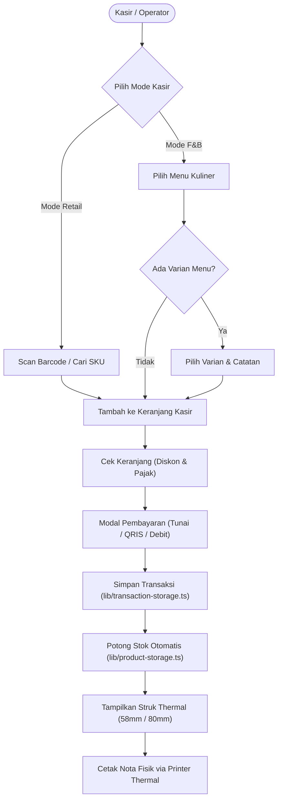

# 🛒 AmirPOS: Aplikasi Kasir Web Dual-Mode (Retail & F&B)

**AmirPOS** adalah aplikasi kasir (*Point of Sale* / POS) berbasis web modern yang dirancang untuk kebutuhan operasional UMKM, baik toko retail/kelontong maupun kedai kafe, kuliner, dan resto. Dibangun menggunakan **Next.js 16 (App Router)**, **React 19**, **Tailwind CSS v4**, dan **TypeScript (Strict Mode)** dengan kapabilitas **Progressive Web App (PWA)** *offline-first*.

Aplikasi ini mengintegrasikan mesin kasir dual-mode yang fleksibel, pemindaian barcode USB, manajemen varian menu, kalkulasi diskon & pajak dinamis, manajemen inventori stok lokal, cetak struk thermal (58mm & 80mm), serta dasbor riwayat transaksi dan rekap omzet harian.

---

## ⚡ Fitur Utama

### 1. Dual-Mode POS Engine (Retail & F&B)
* **Mode Retail (Toko Kelontong & Minimarket)**:
  * Pemindaian barcode cepat menggunakan USB Barcode Scanner gun maupun input manual (shortcut keyboard `/`).
  * Tampilan informasi SKU, barcode produk, satuan unit, dan stok sisa secara *real-time*.
  * Alur kasir langsung ke nama pembeli dan pembayaran tanpa memerlukan nomor meja.
* **Mode F&B (Kedai Kopi, Kafe & Kuliner)**:
  * Dukungan manajemen Nomor Meja dan tipe pemesanan (*Dine In* / *Take Away*).
  * Pemilihan varian menu fleksibel (misal: Regular/Large, Ice/Hot, Topping) dengan penyesuaian harga (`priceDelta`).
  * Catatan pesanan khusus (*custom notes*) per item (misal: "less sugar", "tanpa es").

### 2. Transaksi & Kalkulasi Finansial Fleksibel
* **Multi-Metode Pembayaran**: Mendukung pembayaran Tunai (dengan kalkulator uang diterima dan hitung kembalian otomatis), QRIS, Kartu Debit, dan Transfer Bank.
* **Diskon Dinamis**: Input potongan diskon nominal per transaksi secara langsung di register kasir.
* **Pajak Fleksibel**: Pilihan tarif pajak sesuai regulasi usaha (0% Bebas Pajak, 10% PB1 Resto/Kafe, atau 11% PPN).

### 3. Cetak Struk Thermal (58mm & 80mm)
* Format nota kasir formal siap cetak langsung via dialog printer peramban (`window.print()`).
* Pilihan lebar kertas struk:
  * **58mm**: Format kompak untuk printer kasir thermal portable atau Bluetooth.
  * **80mm**: Format standar untuk printer kasir thermal desktop USB/LAN.
* CSS print teroptimasi (`@media print`) yang menghilangkan elemen browser seperti header, footer, dan margin yang tidak diinginkan.

### 4. Manajemen Produk & Pengurangan Stok Otomatis
* Penambahan, pengeditan, dan penghapusan produk langsung dari antarmuka register kasir.
* Pengurangan stok produk secara otomatis dan aman setiap kali transaksi penjualan berhasil diselesaikan.
* Tombol reset data katalog kembali ke setelan default awal untuk mempermudah simulasi atau pengujian.

### 5. Dasbor Riwayat & Laporan Omzet
* Pantau metrik ringkasan penjualan harian: Total Omzet, Total Transaksi, Rata-rata Nilai Pesanan (*Average Order Value*), serta perbandingan omzet Retail vs F&B.
* Pencarian dan penyaringan riwayat nota berdasarkan nomor order, nama pelanggan, mode bisnis, metode pembayaran, dan tipe pesanan.
* Fitur cetak ulang struk nota penjualan lampau kapan saja.

### 6. Arsitektur Reaktif & Offline-First
* State management berbasis `useSyncExternalStore` dengan sinkronisasi ke `localStorage` (`amirpos_products_v2` dan `amirpos_transactions_v2`).
* Menjamin konsistensi data (*referential stability*), mencegah *hydration mismatch* SSR, serta mendukung operasi kasir tanpa ketergantungan koneksi internet.

### 7. Keamanan Jaringan & Proteksi Edge (Proxy)
* Middleware keamanan di `src/proxy.ts` yang memblokir pemindaian path mencurigakan (probe traversal, file sensitif `.env`, config).
* Filter pencegahan bot otomatis dan pemindai kerentanan (*malicious vulnerability scanners*).
* Sistem pembatas laju permintaan (*Rate Limiter*) berbasis sliding-window token bucket dengan header `X-RateLimit-*`.

---

## 🏗️ Arsitektur Alur Transaksi Kasir



---

## 📁 Struktur Direktori Proyek

```
kasir-web/
├── public/                     # Aset statis, ikon PWA, dan service worker
├── src/                        # 📂 Seluruh source code aplikasi
│   ├── app/                    # Next.js App Router
│   │   ├── _components/        # Komponen UI global (Header, Footer, Metrics, UI kit)
│   │   │   ├── overview-metrics.tsx # Kartu ringkasan omzet real-time
│   │   │   ├── header.tsx      # Navigasi utama, jam kasir digital, status shift
│   │   │   ├── footer.tsx      # Footer aplikasi
│   │   │   └── ui/             # Button, Badge, Modal reusable
│   │   ├── _hooks/             # Custom React Hooks
│   │   │   ├── use-pos-cart.ts # State keranjang kasir, diskon, pajak, barcode scanner
│   │   │   └── use-transactions.ts # Hook pembaca riwayat transaksi & metrik
│   │   ├── pos/                # Halaman Register Kasir (POS)
│   │   │   ├── page.tsx        # Server Component + Metadata SEO
│   │   │   └── pos-client.tsx  # Register kasir dual-mode interaktif
│   │   ├── transaksi/          # Halaman Riwayat Transaksi & Laporan
│   │   │   ├── page.tsx        # Server Component + Metadata SEO
│   │   │   └── transactions-client.tsx # Laporan penjualan, filter & cetak ulang
│   │   ├── globals.css         # Styling Tailwind CSS v4 (@theme inline) & CSS Print
│   │   ├── layout.tsx          # Root Layout (ThemeProvider, Font Geist, JSON-LD)
│   │   ├── manifest.ts         # Manifest Web App (PWA)
│   │   ├── page.tsx            # Beranda: ringkasan operasional & katalog unggulan
│   │   ├── providers.tsx       # Provider wrapper tema (next-themes)
│   │   ├── robots.ts           # Generator robots.txt
│   │   ├── sitemap.ts          # Generator sitemap.xml
│   │   └── sw.ts               # Service Worker Serwist (PWA offline caching)
│   ├── data/                   # Data benih (Seed Data)
│   │   └── menu.json           # Katalog awal produk Retail & F&B
│   ├── dictionaries/           # File terjemahan i18n
│   │   ├── id.json             # Bahasa Indonesia (Default)
│   │   └── en.json             # English
│   ├── i18n/                   # Konfigurasi locale
│   │   └── config.ts           # Definisi bahasa yang didukung
│   ├── lib/                    # Library & modul utilitas
│   │   ├── __tests__/          # Rangkaian Unit Test (Vitest / Bun Test)
│   │   ├── crypto.ts           # Modul enkripsi AES-256-GCM (server-only)
│   │   ├── dictionaries.ts     # Loader dictionary (server-only)
│   │   ├── i18n-actions.ts     # Server Action pengatur cookie bahasa
│   │   ├── i18n-server.ts      # Pembaca locale & dictionary server-side
│   │   ├── obfuscator.ts       # Obfuscator Sqids ID
│   │   ├── product-storage.ts  # Mesin penyimpanan produk & pengurangan stok
│   │   ├── rate-limiter.ts     # Token-bucket rate limiter sliding window
│   │   ├── security-guards.ts  # Deteksi path mencurigakan & bot scanner
│   │   ├── seo.ts              # Utilitas SEO & Schema.org JSON-LD
│   │   └── transaction-storage.ts # Mesin penyimpanan riwayat transaksi kasir
│   ├── proxy.ts                # Middleware keamanan & proteksi rate limiting
│   └── types/                  # Definisi TypeScript
│       └── pos.ts              # Tipe data domain kasir, item, transaksi, dan metrik
├── cli/                        # Utilitas CLI pembantu
├── docs/                       # Dokumentasi rancangan & rencana implementasi
├── GUIDELINE.md                # 📌 Panduan arsitektur & standar pengkodean proyek
├── next.config.ts              # Konfigurasi Next.js 16 & Serwist PWA
├── tsconfig.json               # Konfigurasi TypeScript Strict
├── eslint.config.mjs           # Konfigurasi ESLint v9 flat config
└── package.json                # Skrip & dependensi proyek
```

---

## 🚀 Panduan Memulai

### Prasyarat Sistem
* [Bun](https://bun.sh/) (versi ≥ 1.3 direkomendasikan) atau Node.js (versi ≥ 18)

### 1. Pemasangan Dependensi
Pasang paket dependensi proyek menggunakan Bun:
```bash
bun install
```

### 2. Menjalankan Server Pengembangan
Jalankan dev server lokal:
```bash
bun run dev
```
Buka peramban di [http://localhost:3000](http://localhost:3000).

* Halaman Utama: [http://localhost:3000/](http://localhost:3000/)
* Mesin Kasir (POS): [http://localhost:3000/pos](http://localhost:3000/pos)
* Riwayat Transaksi: [http://localhost:3000/transaksi](http://localhost:3000/transaksi)

### 3. Menjalankan Pengujian (Unit Tests)
Jalankan seluruh rangkaian unit test:
```bash
bun test
```
*Total 36 pengujian mencakup logika kalkulasi keranjang, referential stability storage, proteksi proxy, dan rate limiter.*

### 4. Pemeriksaan Kode (Linting)
Jalankan ESLint untuk memastikan kode mematuhi standar:
```bash
bun run lint
```

### 5. Kompilasi Produksi (Build)
Verifikasi build produksi aplikasi:
```bash
bun run build
```

Jalankan server produksi lokal:
```bash
bun start
```

---

## ⌨️ Pintasan Keyboard Kasir

Untuk mempercepat kerja kasir di lapangan, AmirPOS mendukung beberapa pintasan keyboard praktis:

| Tombol / Pintasan | Aksi |
| ----------------- | ---- |
| `/`               | Langsung fokus ke kolom pencarian produk atau pemindai barcode |
| `Enter`           | Tambahkan produk hasil scan barcode ke keranjang |
| `Esc`             | Menutup jendela modal aktif (modal pembayaran, varian, struk) |

---

## 📄 Format Cetak Struk Kasir

Nota struk kasir didesain khusus agar pas di printer thermal tanpa potongan terpotong:

1. **Header Struk**: Nama toko (AmirPOS), alamat, waktu transaksi, dan nomor order.
2. **Keterangan Pesanan**: Nomor meja dan jenis pemesanan (untuk F&B), atau nama pembeli (untuk Retail).
3. **Daftar Barang**: Nama barang, nama varian terpilih, kuantitas, harga satuan, dan subtotal.
4. **Rincian Finansial**: Subtotal, nominal diskon, tarif & nilai pajak, serta total tagihan akhir.
5. **Detail Pembayaran**: Metode pembayaran terpilih, jumlah uang diserahkan, dan nominal kembalian.
6. **Footer**: Ucapan terima kasih dan barcode referensi transaksi.

---

## 🛡️ Variabel Lingkungan (.env)

Konfigurasi lingkungan diatur melalui file `.env`. Untuk pengembangan lokal, salin file contoh:

```bash
cp .env.example .env.local
```

### Variabel Utama:
* `NEXT_PUBLIC_APP_URL`: URL basis aplikasi (contoh: `http://localhost:3000` di lokal).
* `ENCRYPTION_KEY`: Kunci rahasia 32 karakter (256-bit) untuk utilitas server-only AES-256-GCM.
* `SQIDS_ALPHABET`: Deretan karakter alfabet acak untuk penyamaran ID numerik via Sqids.
